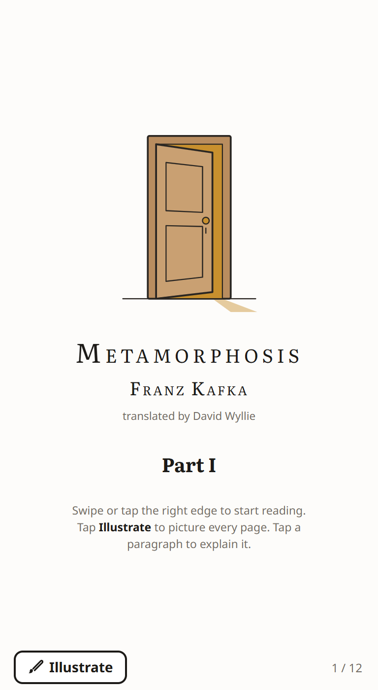
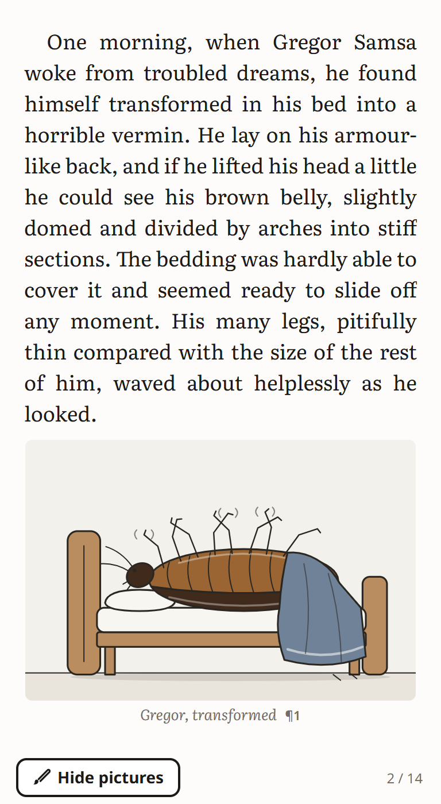
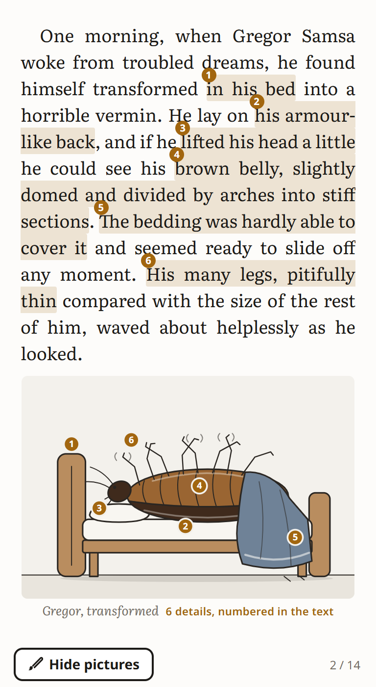
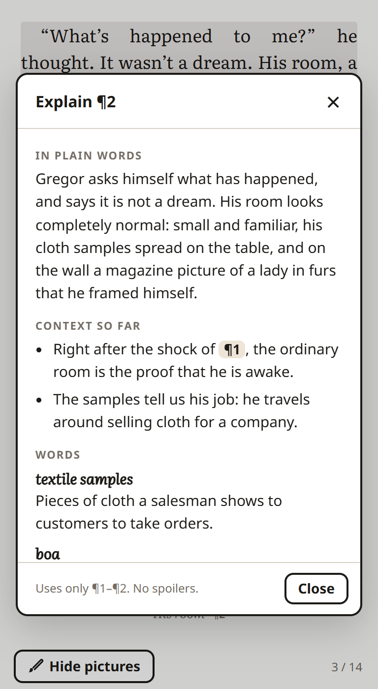

# Illustrated Reader

An e-reader prototype that pictures the story as you read and explains any paragraph, without
calling an AI while you read. Same tap, same picture, on every device.

**Try it:** https://shanmukhapreetham27.github.io/illustrated-reader/ (works on phones, tablets and laptops)

<p>




</p>

The demo text is the opening of Kafka's *Metamorphosis* (Part I, paragraphs 1–9, David Wyllie's
translation).

## The idea

- **Illustrate.** One tap pictures every page. Each picture is placed **after the text it shows**,
  on the same page whenever there is room, at any screen or text size. Tap a picture and numbered
  markers appear on it, matching numbered words in the text: every drawn detail is tied to an
  exact phrase. Tap the button again to hide the pictures.
- **Explain.** Tap a paragraph, then *Explain*. You get a plain-words summary, the context so far,
  the hard words, and why the passage matters. Explanations only look back, so they never spoil
  what comes next.
- **Deterministic.** The AI's work happens once, when a book is added, and is stored as small,
  reviewable data. The reader only renders that data, so every reader sees the same picture and a
  page turn costs nothing.

## How it works

```
ADD A BOOK (once, AI)               BUILD (checks)                       READ (every tap, no AI)
data/scenes.json  scene specs  -->  build/build.py: every quote must  --> src/art.js     spec -> SVG picture
data/explain.json explanations      match the text word for word;         src/reader.js  pages, placement,
                                    explanations may not point ahead;                    Illustrate, Explain
                                    every SVG is fingerprinted
```

A scene spec lists what to draw, and each element quotes the book:

```json
{ "id": "f5", "p": "p6", "scene": "clock", "title": "Quarter to seven",
  "elements": [ { "key": "quarter", "quote": "more like quarter to seven" },
                { "key": "alarm",   "quote": "set for four o’clock" } ],
  "params": { "now": "6:45", "alarm": "4:00" } }
```

The drawing engine turns that into an alarm clock showing 6:45 with the alarm hand on 4. It uses
no randomness except a generator seeded by the picture's id, so the output is byte-identical
everywhere. The *How it works* screen in the app re-checks this on the viewer's own device.

Placement rule: a picture goes after the last sentence it quotes. If that sentence ends at the
foot of a page with no room left, the picture opens the next page at the first sentence break,
the way a printed book does.

## Run it yourself

Download the repository (Code → Download ZIP) and open `index.html` in any browser. It is one
self-contained file and also works offline (without internet it uses a standard font).

Controls: swipe, or tap the left or right edge, to turn pages; tap the top of the page for the
menu (text size, night mode, How it works, Credits); tap the page number to switch to a
percentage. Keyboard: arrow keys, `I` to illustrate, `M` for the menu.

## Build and test

Needs Python 3 and Node 18+ (and Chrome or Edge for the tests).

```bash
python -I build/build.py      # check the data, fingerprint the pictures, write index.html
node tests/run.mjs            # headless Chrome at 6 screen sizes, screenshots in tests/out/
node tests/device.mjs SERIAL "readerSelfTest()"   # same checks inside Chrome on a USB Android phone
```

The tests check, at phone, tablet (portrait and landscape), small-phone, large-text and desktop sizes:

- every picture comes after all the text it quotes, is whole, and never overlaps text;
- laying the book out twice gives an identical result;
- every picture drawn in the browser is byte-identical to the one drawn at build time;
- one Illustrate tap places every picture and keeps the reader's place; a second tap hides them.

## Project layout

| Path | What |
| --- | --- |
| `index.html` | The app: one self-contained page (built) |
| `data/text.json` | The excerpt, extracted from an EPUB by `build/extract.py` |
| `data/scenes.json` | 6 scene specs (30 quoted phrases) and why some paragraphs get no picture |
| `data/explain.json` | One explanation per paragraph |
| `src/art.js` | SVG drawing engine (6 scenes) |
| `src/reader.js` | Pagination, picture placement, Illustrate, Explain, gestures, self-tests |
| `src/reader.css`, `src/template.html` | Look and markup (light and night themes) |
| `docs/screenshots/` | Images used in this README |

## Limits

- Pictures and explanations exist only for these nine paragraphs. A new book needs a new
  "add a book" pass to write its specs.
- The pictures are deliberately simple line drawings; the point is that each one is grounded in
  the text and reproducible.

## Credits and licenses

- **Code:** MIT License (see `LICENSE`).
- **Text:** Franz Kafka, *Die Verwandlung* (1915). English translation by David Wyllie, from
  Project Gutenberg eBook #5200, a copyrighted eBook distributed with the translator's permission
  and reused here under the [Project Gutenberg License](https://www.gutenberg.org/policy/license.html).
  The text is not covered by the MIT License.
- **Fonts:** Literata, Charis SIL and Noto Sans via Google Fonts (SIL Open Font License).
- The reading view is modelled on [KOReader](https://koreader.rocks); no KOReader code is used.
- The title page shows a door rather than the insect: in 1915 Kafka asked his publisher not to
  draw the insect on the cover.
